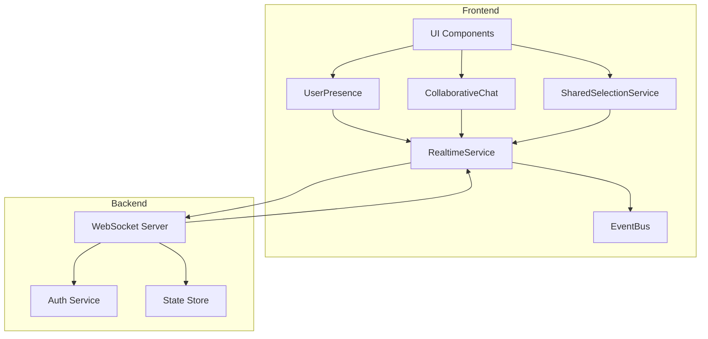

# Arquitetura de Colaboração Realtime

## Visão Geral
Sistema de colaboração em tempo real para múltiplos usuários trabalhando no mesmo modelo BIM/IFC.

## Diagrama de Componentes

## Fluxo de Dados

### Conexão WebSocket
1. Frontend conecta ao WebSocket Server
2. Autenticação via token JWT
3. Servidor envia lista de usuários online
4. Frontend atualiza UI de presença

### Chat
1. Usuário envia mensagem
2. RealtimeService envia via WebSocket
3. Servidor broadcast para todos os clientes
4. Clientes recebem e atualizam UI

### Presença
1. Usuário entra/sai
2. Servidor notifica todos os clientes
3. Clientes atualizam lista de usuários
4. Cursores remotos são sincronizados

### Seleção Compartilhada
1. Usuário seleciona elementos
2. SharedSelectionService propaga via RealtimeService