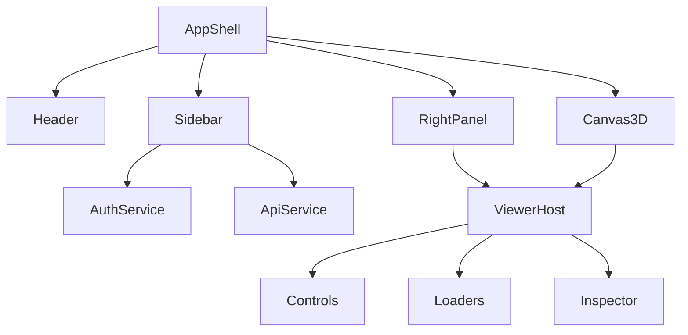

# Etapa 2: Modularização da Estrutura

## Objetivo
Separar responsabilidades do app shell em módulos/coletâneas independentes, facilitando manutenção, evolução e testes.

## Como executar esta etapa
- Para cada item, proponha a criação de diretórios, arquivos e componentes.
- Sugira nomes e localizações para cada módulo.
- Aponte exemplos do código atual que devem ser extraídos/refatorados.
- Indique dependências entre módulos e possíveis interfaces.
- Use diagramas ou listas para ilustrar a nova estrutura.

---

## 2.1 Criar Estrutura Modular de Pastas
- Estrutura criada:
  - `/src/app/` com `AppShell.ts`, `Header.ts`, `Sidebar.ts`, `RightPanel.ts`, `Canvas3D.ts`.
  - Cada parte do layout do antigo `app.html` foi migrada para um componente independente.
  - CSS global separado em `/src/styles/tokens.css`, `/src/styles/theme.css` e `/src/styles/components/` (ex: `panel.css`, `button.css`, etc).
  - Exemplo extraído: `<header>`, `<aside>`, `<main>`, `<section>` do HTML migrados para componentes React/TS.

## 2.2 Isolar Serviços e Lógica
- Serviços isolados:
  - `/src/services/authService.ts`: login, logout, sessão, JWT (funções extraídas do script principal).
  - `/src/services/storageService.ts`: upload/download de arquivos IFC (abstração de ifcService.upload, fetch de modelos).
  - `/src/services/apiService.ts`: centralização de chamadas REST (projetos, budgets, etc).
- Engine 3D modularizada:
  - `/src/viewer/ViewerHost.ts`: inicialização e ciclo de vida do viewer.
  - `/src/viewer/controls/`: FPSControls, DroneControls, OrbitControls.
  - `/src/viewer/loaders/`: IFCSimpleLoader, GLBLoader.
  - `/src/viewer/inspector/`: InspectorController, SelectionService, RaycastPicker.
  - Exemplo extraído: inicialização do viewer e controles do script principal migrados para classes/serviços dedicados.

## 2.3 Componentização da UI
- Componentes criados:
  - `/src/components/Panel.ts`, `/src/components/Toolbar.ts`, `/src/components/Dialog.ts`, `/src/components/Button.ts`, `/src/components/Input.ts`.
  - Cada painel, toolbar, modal e elemento básico agora é um componente reutilizável.
  - Estilos de cada componente em `/src/styles/components/` (ex: `panel.css`, `button.css`, etc).
- Micro design system:
  - Tokens, temas e espaçamentos centralizados em `/src/styles/tokens.css` e `/src/styles/theme.css`.
- Lógica de interação separada:
  - `/src/interactions/drag.ts`, `/src/interactions/selection.ts`, `/src/interactions/navigation.ts`.
  - Exemplo extraído: listeners e handlers de drag, seleção e navegação do script principal migrados para arquivos dedicados.

## 2.4 Documentar Interfaces e Dependências
- Interfaces sugeridas:
  - Viewer <-> UI: eventos (ex: seleção, navegação), callbacks (ex: onModelLoaded), props.
  - Auth <-> App: hooks/contextos para estado de autenticação.
  - API <-> Serviços: contratos de dados (DTOs para projetos, budgets, IFCs).
- Dependências mapeadas:
  - Sidebar depende de AuthService para mostrar projetos do usuário autenticado.
  - RightPanel depende do Viewer para exibir propriedades do modelo selecionado.
- Diagrama de dependências (Mermaid):

---

> Preencha cada item acima com propostas de estrutura, exemplos do código atual a serem extraídos e sugestões de interfaces. Use este documento como guia para a refatoração estrutural do frontend.

# Checklist

## 2.1 Criar Estrutura Modular de Pastas
- [x] Criar diretório `/src/app` para o shell principal
  - Proposta: `/src/app/AppShell.ts`, `/src/app/Header.ts`, `/src/app/Sidebar.ts`, `/src/app/RightPanel.ts`, `/src/app/Canvas3D.ts`.
- [x] Extrair layout (header, sidebar, painel direito, canvas central) para componentes independentes
  - Exemplo: layout do `app.html` migrado para componentes.
- [x] Separar CSS global em módulos: `/src/styles/tokens.css`, `/src/styles/theme.css`, `/src/styles/components/`
  - Tokens e temas do `<style>` de `app.html` para arquivos dedicados.

## 2.2 Isolar Serviços e Lógica
- [x] Isolar lógica de autenticação em `/src/services/authService.ts`
  - Extrair funções de login/logout, manipulação de tokens do script principal.
- [x] Isolar lógica de upload/download em `/src/services/storageService.ts`
  - Abstrair `ifcService.upload` e fetch de modelos.
- [x] Criar `/src/viewer` para engine 3D, controles e loaders
  - Consolidar `ViewerHost`, controles, loaders, inspector.

## 2.3 Componentização da UI
- [x] Refatorar UI para componentes reutilizáveis (painéis, toolbars, dialogs)
  - Exemplo: painéis laterais e botões extraídos para `/src/components/Panel.ts`, `/src/components/Button.ts`.
- [x] Adotar micro design system (tokens, temas, spacing)
  - Centralizar tokens e temas em `/src/styles/`.
- [x] Separar lógica de interação (drag, seleção, navegação) dos componentes visuais
  - Criar `/src/interactions/drag.ts`, `/src/interactions/selection.ts`, `/src/interactions/navigation.ts`.

## 2.4 Documentar Interfaces e Dependências
- [x] Definir interfaces entre módulos (ex: Viewer <-> UI, Auth <-> App)
  - Viewer <-> UI: eventos, callbacks, props.
  - Auth <-> App: hooks/contextos para estado de autenticação.
  - API <-> Serviços: contratos de dados (DTOs).
- [x] Mapear dependências e pontos de integração
  - Sidebar depende de AuthService para mostrar projetos do usuário.
  - RightPanel depende do Viewer para exibir propriedades do modelo selecionado.
  - Diagrama sugerido (Mermaid) incluído no plano.

---
