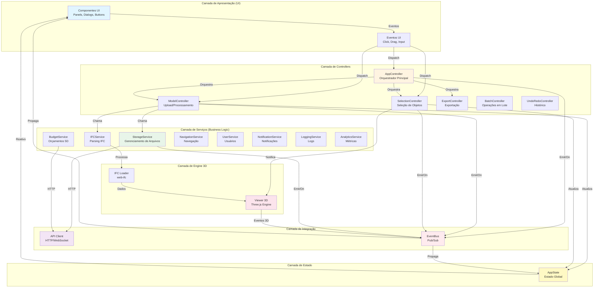
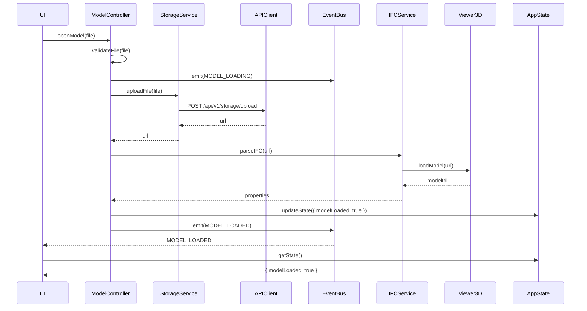
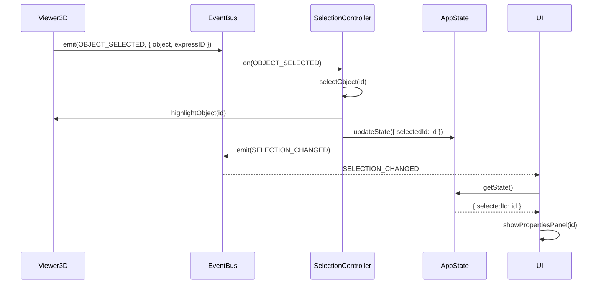
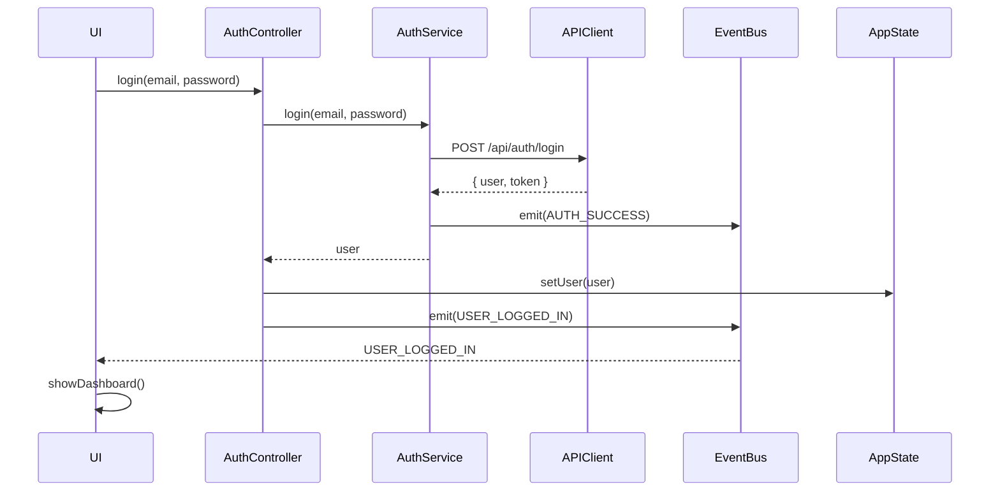

# Diagrama de Camadas - Arquitetura Frontend

## Visão Geral das Camadas

## Dependências Entre Camadas

### Regras de Dependência
- **UI** depende de: Controllers, AppState, EventBus
- **Controllers** dependem de: Serviços, AppState, EventBus
- **Serviços** dependem de: APIClient, EventBus (NÃO dependem de UI)
- **APIClient** depende de: Nenhuma camada superior
- **EventBus** é: Singleton global, acessível por todas as camadas
- **AppState** é: Singleton global, acessível por todas as camadas
- **Engine 3D** depende de: EventBus (emite eventos), independente de UI

### Matriz de Dependência

| Camada | UI | Controllers | Serviços | APIClient | EventBus | AppState | Engine 3D |
|--------|-----|-------------|----------|-----------|----------|----------|-----------|
| UI | - | ✅ | ❌ | ❌ | ✅ | ✅ | ❌ |
| Controllers | ❌ | - | ✅ | ❌ | ✅ | ✅ | ✅ |
| Serviços | ❌ | ❌ | - | ✅ | ✅ | ❌ | ❌ |
| APIClient | ❌ | ❌ | ❌ | - | ❌ | ❌ | ❌ |
| EventBus | ❌ | ❌ | ❌ | ❌ | - | ❌ | ✅ |
| AppState | ❌ | ❌ | ❌ | ❌ | ✅ | - | ❌ |
| Engine 3D | ❌ | ❌ | ❌ | ❌ | ✅ | ❌ | - |

## Fluxos Típicos

### Fluxo 1: Upload de Arquivo IFC

### Fluxo 2: Seleção de Objeto 3D

### Fluxo 3: Login de Usuário

## Contratos de Interface

### EventBus
- `on(event, callback, priority?, filter?)` - Registra listener
- `off(event, callback)` - Remove listener
- `emit(event, data)` - Emite evento síncrono
- `emitAsync(event, data)` - Emite evento assíncrono
- `once(event, callback, priority?)` - Listener único

### BaseController
- `executeAsync(operation, context)` - Executa operação com error handling
- `setState(newState)` - Atualiza estado local
- `getState()` - Retorna estado local
- `setProgressCallback(callback)` - Configura callback de progresso
- `setErrorCallback(callback)` - Configura callback de erro
- `setSuccessCallback(callback)` - Configura callback de sucesso

### ModelController
- `openModel(file, options)` - Abre e processa modelo
- `closeModel()` - Fecha modelo atual
- `reloadModel()` - Recarrega modelo
- `getModelProperties()` - Retorna propriedades do modelo
- `isModelLoaded()` - Verifica se modelo está carregado

### SelectionController
- `selectObject(id, options)` - Seleciona objeto
- `deselectObject(id)` - Deseleciona objeto
- `clearSelection()` - Limpa seleção
- `getSelectedObjects()` - Retorna objetos selecionados
- `setMultiSelect(enabled)` - Habilita multi-select

### StorageService
- `uploadFile(file, path, options)` - Upload de arquivo
- `downloadFile(path, options)` - Download de arquivo
- `listFiles(params)` - Lista arquivos
- `deleteFile(path)` - Deleta arquivo
- `getFileMetadata(path)` - Retorna metadados
- `getFileVersions(path)` - Retorna versões

## Principais Eventos

### Model Events
- `MODEL_LOADING` - Início do carregamento
- `MODEL_LOADED` - Modelo carregado com sucesso
- `MODEL_ERROR` - Erro no carregamento
- `MODEL_SELECTED` - Modelo selecionado

### Selection Events
- `OBJECT_SELECTED` - Objeto selecionado
- `OBJECT_DESELECTED` - Objeto deselecionado
- `SELECTION_CHANGED` - Seleção alterada

### Tool Events
- `TOOL_ACTIVATED` - Ferramenta ativada
- `TOOL_DEACTIVATED` - Ferramenta desativada
- `TOOL_CHANGED` - Ferramenta alterada

### Camera Events
- `CAMERA_MODE_CHANGED` - Modo de câmera alterado
- `CAMERA_POSITION_CHANGED` - Posição alterada
- `CAMERA_FOCUS_SELECTION` - Foco na seleção

### UI Events
- `UI_PANEL_OPENED` - Painel aberto
- `UI_PANEL_CLOSED` - Painel fechado
- `UI_MODAL_OPEN` - Modal aberto
- `UI_MODAL_CLOSE` - Modal fechado

### Project Events
- `PROJECT_NEW` - Novo projeto
- `PROJECT_SAVE` - Salvar projeto
- `PROJECT_SAVED` - Projeto salvo
- `PROJECT_LOAD` - Carregar projeto
- `PROJECT_LOADED` - Projeto carregado

## Status de Implementação

### ✅ Implementado
- EventBus - Sistema completo de pub/sub com prioridades e filtros
- BaseController - Classe base com callbacks e estado
- ModelController - Orquestração de upload/processamento
- SelectionController - Gerenciamento de seleção
- StorageService - Integração completa com MinIO
- BudgetService - Orquestração 5D completa
- AppController - Orquestrador principal da aplicação

### ⚠️ Parcialmente Implementado
- IFCService - Apenas interface/esqueleto (falta parsing real)
- NavigationService - Existe NavigationManager mas não segue especificação
- AuthService - Implementação básica existe mas não segue especificação OAuth2

### ❌ Não Implementado
- UserService - Serviço completo de usuários
- NotificationService - Sistema de notificações
- LoggingService - Logging estruturado
- AnalyticsService - Coleta de métricas
- PluginService - Sistema de plugins
- FederationService - Federação de modelos
- AutomationService - Orquestração de automações
- IntegrationService - Integrações externas
