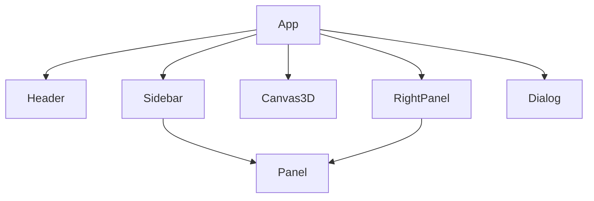

# Etapa 4: UI e Componentização

## Objetivo
Refatorar a interface do usuário para componentes reutilizáveis, adotar um design system consistente e separar claramente a lógica de interação da apresentação visual.

## Como executar esta etapa
- Identifique elementos recorrentes na UI e proponha componentes genéricos.
- Estruture `/src/components/` para componentes visuais e `/src/interactions/` para lógica de interação.
- Centralize tokens e temas em `/src/styles/`.
- Garanta que componentes recebam props/eventos e não implementem lógica de domínio.
- Documente exemplos de uso, composição e fluxo de dados/eventos.

---

## 4.1 Refatorar UI em Componentes Reutilizáveis
- Componentize elementos como:
  - Panel (painel lateral)
  - Toolbar (barra de ferramentas)
  - Dialog (modal genérico)
  - Button, Input, Select (elementos básicos)
- Exemplo de estrutura:
  - `/src/components/Panel.ts`
  - `/src/components/Toolbar.ts`
  - `/src/components/Dialog.ts`
  - `/src/components/Button.ts`
- Componentes devem ser puros, receber props e emitir eventos/callbacks.
- Exemplo TypeScript:

```typescript
// Panel.ts
export function Panel({ title, children, onClose }) {
  return (
    <aside className="panel">
      <header>{title} <button onClick={onClose}>×</button></header>
      <div>{children}</div>
    </aside>
  );
}
```

## 4.2 Adotar Micro Design System
- Centralize tokens (cores, espaçamentos, fontes) em `/src/styles/tokens.css`:

```css
:root {
  --color-primary: #0057b8;
  --spacing-md: 16px;
  --font-family: 'Inter', sans-serif;
}
```
- Defina temas (dark/light, glassmorphism) em `/src/styles/theme.css`:

```css
[data-theme="dark"] {
  --color-bg: #181c24;
  --color-panel: rgba(30,34,44,0.85);
}
```
- Documente exemplos de uso dos tokens e temas nos componentes.

## 4.3 Separar Lógica de Interação
- Isolar lógica de drag, seleção, navegação em `/src/interactions/`:
  - `/src/interactions/drag.ts`
  - `/src/interactions/selection.ts`
  - `/src/interactions/navigation.ts`
- Componentes visuais apenas recebem callbacks, não implementam lógica de domínio.
- Exemplo:

```typescript
// Button.ts
export function Button({ onClick, children }) {
  return <button onClick={onClick}>{children}</button>;
}

// Uso
<Button onClick={handleSave}>Salvar</Button>
```

## 4.4 Documentar Componentização
- Crie diagrama de composição de componentes (exemplo Mermaid):


- Exemplifique fluxo de dados/eventos:
  - Usuário clica em botão → evento para controller → atualização de estado → props atualizam componente

---

> Preencha cada item acima com exemplos de componentes, estrutura de pastas, tokens, temas e padrões de interação. Use este documento como guia para a componentização e evolução da UI.

# Checklist

## 4.1 Refatorar UI em Componentes Reutilizáveis
- [ ] Identificar elementos recorrentes (painéis, toolbars, dialogs, botões, inputs)
- [ ] Criar diretório `/src/components/` para componentes genéricos
- [ ] Exemplos:
  - `/src/components/Panel.ts` (painel lateral)
  - `/src/components/Toolbar.ts` (barra de ferramentas)
  - `/src/components/Dialog.ts` (modal genérico)
  - `/src/components/Button.ts`, `/src/components/Input.ts` (elementos básicos)
- [ ] Garantir que componentes sejam desacoplados de lógica de domínio

## 4.2 Adotar Micro Design System
- [ ] Centralizar tokens de design (cores, espaçamentos, fontes) em `/src/styles/tokens.css`
- [ ] Definir temas (dark/light, glassmorphism) em `/src/styles/theme.css`
- [ ] Criar documentação dos padrões visuais e exemplos de uso

## 4.3 Separar Lógica de Interação
- [ ] Isolar lógica de drag, seleção, navegação em `/src/interactions/`
- [ ] Componentes visuais recebem props/eventos, mas não implementam lógica de domínio
- [ ] Exemplo: `Panel` recebe callback `onSelect`, mas não sabe o que é selecionado

## 4.4 Documentar Componentização
- [ ] Criar diagrama de composição de componentes (ex: Mermaid)
- [ ] Exemplificar fluxo de dados e eventos entre componentes e controllers

---
