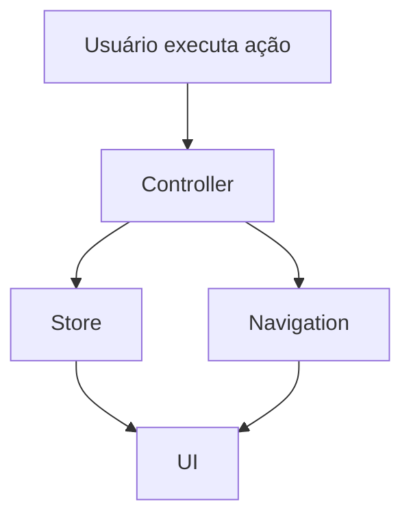

# Etapa 5: Estado e Navegação

## Objetivo
Implementar uma gestão de estado centralizada e modular, além de organizar a navegação e modos de visualização, garantindo previsibilidade, escalabilidade e facilidade de manutenção.

## Como executar esta etapa
- Escolha um state manager leve (ex: Zustand, Context API, pub/sub customizado) conforme a complexidade do app.
- Estruture `/src/state/` para stores e hooks, e `/src/navigation/` para rotas e modos.
- Defina o shape do estado global e contratos de atualização.
- Documente exemplos de fluxo de atualização de estado e navegação.

---

## 5.1 Implementar State Manager
- Exemplo com Zustand:

```typescript
// userStore.ts
import { create } from 'zustand';
export const useUserStore = create(set => ({
  user: null,
  setUser: (user) => set({ user }),
  logout: () => set({ user: null })
}));
```
- Estruture stores para cada domínio:
  - `/src/state/userStore.ts` (usuário e sessão)
  - `/src/state/projectStore.ts` (projeto ativo)
  - `/src/state/modelStore.ts` (modelo carregado)
  - `/src/state/navigationStore.ts` (modo de navegação, rota atual)
- Controllers e UI consomem estado via hooks.

## 5.2 Centralizar Estado Global
- Defina o shape do estado global:

```typescript
interface GlobalState {
  user: User | null;
  project: Project | null;
  model: Model | null;
  selection: Selection | null;
  navigationMode: 'fps' | 'drone' | 'orbit' | 'xr';
}
```
- Implemente provedores de estado para acesso em toda a aplicação.
- Documente eventos de atualização (ex: onUserChange, onModelLoaded).

## 5.3 Modularizar Navegação e Modos
- Estruture `/src/navigation/`:
  - `/src/navigation/routes.ts` (rotas principais)
  - `/src/navigation/modes.ts` (modos de visualização)
- Exemplo de rotas:

```typescript
export const routes = [
  { path: '/', component: Home },
  { path: '/viewer', component: Viewer },
  { path: '/budgets', component: Budgets },
];
```
- Exemplo de modos:

```typescript
export type NavigationMode = 'fps' | 'drone' | 'orbit' | 'xr';
```
- Garanta transições previsíveis e desacopladas (ex: navegação via eventos ou hooks).

## 5.4 Documentar Fluxos de Estado e Navegação
- Diagrama de fluxo (exemplo Mermaid):


- Exemplo de ciclo:
  - Usuário seleciona modo FPS → controller atualiza navigationStore → UI re-renderiza canvas 3D no novo modo
  - Login → userStore atualizado → UI mostra painel de projetos

---

> Preencha cada item acima com exemplos de stores, hooks, rotas, modos e fluxos de atualização. Use este documento como guia para a gestão de estado e navegação do frontend.

# Checklist

## 5.1 Implementar State Manager
- [ ] Escolher solução de estado (ex: Zustand, Context API, custom pub/sub)
- [ ] Criar `/src/state/` para stores e hooks
- [ ] Exemplo de store:
  - `/src/state/userStore.ts` (usuário e sessão)
  - `/src/state/projectStore.ts` (projeto ativo)
  - `/src/state/modelStore.ts` (modelo carregado)
- [ ] Garantir que controllers e UI consumam estado via hooks/observers

## 5.2 Centralizar Estado Global
- [ ] Definir shape do estado global (usuário, projeto, modelo, seleção, modo de navegação)
- [ ] Implementar provedores de estado para acesso em toda a aplicação
- [ ] Documentar contratos e eventos de atualização

## 5.3 Modularizar Navegação e Modos
- [ ] Organizar rotas e modos de visualização (FPS, drone, orbit, 5D, XR)
- [ ] Criar `/src/navigation/` para lógica de rotas e modos
- [ ] Exemplo:
  - `/src/navigation/routes.ts` (rotas principais)
  - `/src/navigation/modes.ts` (modos de visualização)
- [ ] Garantir transições previsíveis e desacopladas

## 5.4 Documentar Fluxos de Estado e Navegação
- [ ] Criar diagrama de fluxo de atualização de estado (ex: Mermaid)
- [ ] Exemplificar ciclo: ação do usuário → atualização de estado → UI reativa

---
