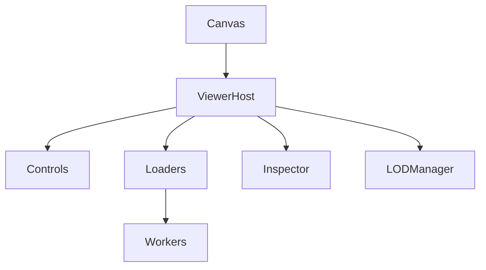

# Etapa 6: Performance e Arquitetura 3D

## Objetivo
Isolar e otimizar a engine Three.js, preparar o frontend para lidar com grandes modelos BIM/IFC, e planejar estratégias de performance e escalabilidade para visualização 3D.

## Como executar esta etapa
- Estruture `/src/viewer/` para engine, controles, loaders e inspector.
- Implemente parsing pesado (IFC, GLB) em web workers para não travar a UI.
- Planeje e documente estratégias de LOD (Level of Detail) e streaming de geometria.
- Monitore e otimize uso de memória e recursos.
- Use diagramas para ilustrar arquitetura e fluxos.

---

## 6.1 Isolar Engine Three.js
- Estruture `/src/viewer/`:
  - `ViewerHost.ts`: inicialização, ciclo de vida, resize, render loop
  - `controls/`: FPSControls.ts, DroneControls.ts, OrbitControls.ts
  - `loaders/`: IFCLoader.ts, GLBLoader.ts, outros formatos
  - `inspector/`: SelectionService.ts, Raycast.ts, BoundingBox.ts
- Exemplo:

```typescript
// ViewerHost.ts
export class ViewerHost {
  constructor(canvas: HTMLCanvasElement) { /* ... */ }
  addModel(model) { /* ... */ }
  setControls(mode: 'fps' | 'drone' | 'orbit') { /* ... */ }
  dispose() { /* ... */ }
}
```
- Engine deve ser desacoplada da UI e dos serviços (apenas recebe comandos/props).

## 6.2 Usar Web Workers para Parsing Pesado
- Implemente parsing de IFC/GLB em web workers:
  - `/src/workers/ifcWorker.ts`: recebe arquivo, faz parsing, retorna estrutura pronta
  - `/src/workers/glbWorker.ts`: idem para GLB
- Comunicação via postMessage/onmessage:

```typescript
// Main thread
const worker = new Worker('./ifcWorker.ts');
worker.postMessage(file);
worker.onmessage = (event) => { const model = event.data; /* ... */ };
```
- Workers liberam a main thread para UI responsiva.

## 6.3 Planejar LOD e Streaming de Geometria
- Defina níveis de detalhe (LOD):
  - LOD0: bounding box
  - LOD1: geometria simplificada
  - LOD2: geometria completa
- Implemente carregamento sob demanda:
  - Carregar partes do modelo conforme navegação/câmera
  - Descarregar partes distantes ou não visíveis
- Exemplo de integração:

```typescript
viewerHost.setLOD('auto');
viewerHost.loadSection(sectionId);
```

## 6.4 Otimizar Memória e Recursos
- Monitore uso de memória (ex: window.performance.memory)
- Libere recursos não utilizados:
  - `model.dispose()` ao trocar de modelo
  - Descarregar texturas e buffers não visíveis
- Documente práticas:
  - Evitar múltiplas cópias de grandes buffers
  - Usar geometria instanciada quando possível

## 6.5 Documentar Arquitetura 3D
- Diagrama de módulos (exemplo Mermaid):


- Fluxo típico:
  - Usuário faz upload IFC → ifcWorker faz parsing → ViewerHost recebe modelo → renderiza → usuário interage (seleção, navegação)

---

> Preencha cada item acima com exemplos de módulos, workers, estratégias de LOD/streaming e diagramas. Use este documento como guia para a performance e arquitetura 3D do frontend.

# Checklist

## 6.1 Isolar Engine Three.js
- [ ] Criar `/src/viewer/` para engine 3D e submódulos
- [ ] Garantir que a engine seja desacoplada da UI e dos serviços

## 6.2 Usar Web Workers para Parsing Pesado
- [ ] Implementar parsing de IFC/GLB em web workers para não travar a UI
- [ ] Documentar comunicação entre main thread e workers

## 6.3 Planejar LOD e Streaming de Geometria
- [ ] Definir estratégia de LOD para grandes modelos
- [ ] Planejar streaming de geometria sob demanda
- [ ] Documentar pontos de integração com o viewer

## 6.4 Otimizar Memória e Recursos
- [ ] Monitorar uso de memória e liberar recursos não utilizados
- [ ] Implementar descarregamento de modelos e texturas não visíveis
- [ ] Documentar práticas recomendadas para performance

## 6.5 Documentar Arquitetura 3D
- [ ] Criar diagrama de módulos 3D (ex: Mermaid)
- [ ] Exemplificar fluxo: carregamento → parsing → renderização → interação

---
