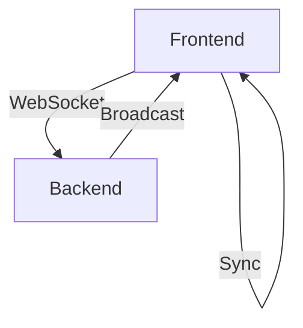
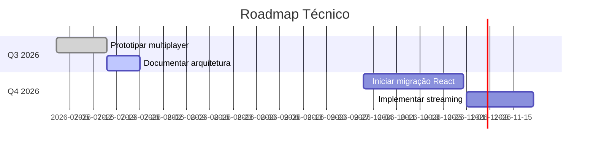

# Etapa 8: Evolução e Futuro

## Objetivo
Planejar a evolução contínua do frontend, prevendo integrações avançadas, adoção de novas tecnologias e documentação da arquitetura para garantir escalabilidade e inovação.

## Como executar esta etapa
- Liste possíveis integrações e recursos futuros (multiplayer, realtime, streaming, frameworks reativos).
- Sugira estratégias para adoção incremental de novas tecnologias.
- Proponha práticas de documentação e atualização arquitetural.
- Defina um roadmap técnico de médio/longo prazo.

---

## 8.1 Planejar Integração de Multiplayer/Realtime
- Avalie cenários de colaboração em tempo real (ex: edição simultânea de modelos, chat, presença de usuários).
- Sugira uso de WebSocket, Socket.IO, SignalR ou WebRTC para comunicação realtime.
- Exemplo de arquitetura:

- Prototipe integração mínima: presença de usuários, chat ou edição colaborativa.
- Documente requisitos de escalabilidade e segurança.

## 8.2 Avaliar Frameworks Reativos e Modernos
- Analise vantagens e riscos de migrar para React, Vue, Svelte ou Solid.
- Sugira abordagem incremental:
  - Micro frontends: módulos independentes coexistindo com o app atual.
  - Wrapper progressivo: componentes reativos em áreas críticas (ex: painéis, formulários).
- Critérios para escolha:
  - Comunidade, performance, curva de aprendizado, integração com stack atual.
- Documente plano de migração e pontos de integração.

## 8.3 Documentar Arquitetura e Padrões
- Mantenha diagramas atualizados (Mermaid, C4, etc).
- Use Storybook para documentação viva de componentes.
- Registre decisões arquiteturais (ADR - Architecture Decision Records):
  - Exemplo: "Decisão #001 - Adoção de WebSocket para colaboração realtime".
- Crie um repositório central de documentação técnica.

## 8.4 Roadmap Técnico de Evolução
- Defina milestones para recursos avançados:
  - Multiplayer, streaming de geometria, LOD dinâmico, workers distribuídos.
- Exemplo de roadmap:

- Priorize iniciativas conforme valor de negócio e feedback dos usuários.
- Revise roadmap periodicamente com base em métricas e evolução do produto.

---

> Preencha cada item acima com propostas de integração, estratégias de adoção tecnológica, práticas de documentação e roadmap técnico. Use este documento como guia para a evolução contínua do frontend.

# Checklist

## 8.1 Planejar Integração de Multiplayer/Realtime
- [ ] Avaliar uso de WebSocket para colaboração em tempo real
- [ ] Mapear cenários de uso: edição simultânea, chat, presença, etc
- [ ] Prototipar integração com backend realtime (ex: Socket.IO, SignalR)

## 8.2 Avaliar Frameworks Reativos e Modernos
- [ ] Analisar viabilidade de adoção futura de React, Vue, Svelte ou Solid
- [ ] Planejar migração incremental (ex: micro frontends, integração progressiva)
- [ ] Documentar critérios para escolha de framework

## 8.3 Documentar Arquitetura e Padrões
- [ ] Manter documentação viva da arquitetura (diagramas, contratos, fluxos)
- [ ] Adotar ferramentas como Storybook para documentação de componentes
- [ ] Registrar decisões arquiteturais (ADR - Architecture Decision Records)

## 8.4 Roadmap Técnico de Evolução
- [ ] Definir milestones para recursos avançados (streaming, LOD dinâmico, workers distribuídos)
- [ ] Priorizar refatorações e integrações de acordo com necessidades do produto
- [ ] Revisar roadmap periodicamente com base em feedback e métricas

---
