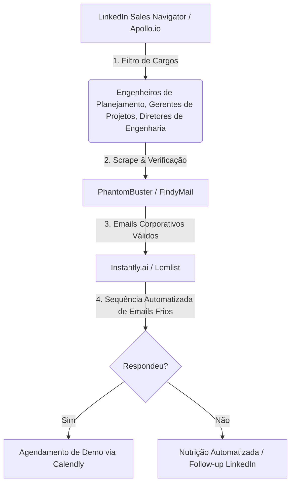

# Estratégia de Prospecção de Clientes Automatizada: ArxisVR

Esta documentação descreve quem é nosso público-alvo, como podemos alcançá-los de forma preditiva e escalável, e a arquitetura técnica de uma ferramenta "Isca Digital" de produto (PLG) para capturar leads de forma 100% automatizada.

---

## 1. Público-Alvo (ICP - Ideal Customer Profile)

| Segmento | Dores Principais | Proposta de Valor ArxisVR |
|---|---|---|
| **Construtoras & Incorporadoras** | - Atrasos no cronograma de obras. - Estouro de orçamento. - Falta de comunicação campo-escritório. | - Simulação 4D/5D em tempo real. - Plataforma colaborativa em VR/AR sem necessidade de óculos caros no escritório. |
| **Escritórios de Engenharia e Arquitetura (AEC)** | - retrabalho por interferências não detectadas (clashes). - Dificuldade em apresentar modelos para clientes leigos. | - Detecção automática de colisões com IA (Copilot). - Link público de compartilhamento 3D rápido. |
| **Gerenciadoras de Obras / Fiscalização** | - Falta de transparência nos relatórios diários de obra. | - Visitas 1:1 imersivas pelo navegador. - Auditoria e histórico de modificações no IFC. |

---

## 2. Estratégia de Prospecção Outbound Automática

### Fluxo de Geração de Demanda (Máquina de Vendas)

### Script de Abordagem Sugerido (Foco em Dor)
> **Assunto:** Erros de compatibilização no projeto [Nome da Construtora]?
>
> Olá, [Nome do Diretor], tudo bem?
>
> Vejo que você gerencia a engenharia da [Nome da Construtora]. Geralmente, construtoras do seu porte perdem de **5% a 12% do orçamento** em retrabalho por colisões (clashes) entre elétrica e hidráulica não identificados na fase de projeto.
>
> Nós desenvolvemos o **ArxisVR**, uma plataforma onde você arrasta seu modelo IFC no navegador e nosso Copilot de IA detecta interferências 3D e gera o cronograma 4D automaticamente, sem precisar de Revit ou Navisworks instalado.
>
> Você teria 5 minutos nesta quinta-feira para ver como gerar esse relatório de clashes do seu projeto atual em tempo real?
>
> Abraços,
> [Seu Nome]

---

## 3. Estratégia PLG (Product-Led Growth): O Validador IFC Gratuito

A melhor forma de prospecção passiva e automatizada é oferecer valor técnico antes da venda. Propomos criar uma **Página Pública de Validação de IFC**.

### Fluxo do Usuário (Isca Digital)
1. O lead acessa a página pública `https://arxisvr.avilaops.com/validador`.
2. A tela exibe uma área de Drag & Drop simples: *"Validador de Modelos IFC Gratuito, Descubra a qualidade do seu arquivo BIM em segundos"*.
3. O lead arrasta o arquivo IFC.
4. O sistema solicita: *"Para onde devemos enviar o relatório completo de qualidade do modelo?"* (Campos: Nome, E-mail Corporativo, Empresa).
5. O sistema faz o upload e chama a API `/api/v1/ifc/validate` de forma anônima.
6. A plataforma executa os parses estruturais (checagem de integridade, número de elementos, colisões espaciais básicas).
7. O sistema dispara um e-mail automatizado pelo **Resend** com o relatório em PDF da qualidade do arquivo (Notas A, B, C, D e recomendações).
8. O contato do lead é adicionado automaticamente na lista de prospecção do time comercial ou CRM (como Hubspot) com a tag `lead-magnet-ifc`.

---

## 4. Plano de Ação Técnica para Implementação da Isca Digital

### Frontend (React)
- **Nova Rota:** `/validador` (pública).
- **Interface:** Layout minimalista, com foco no upload e inserção do e-mail.
- **Micro-animações:** Loader de progresso do upload e análise do IFC.

### Backend (Fastify)
- **Novo Endpoint:** `POST /api/v1/public/ifc-check` (não exige token bearer de autenticação de usuário).
- **Integração Email:** Conectar ao serviço **Resend** para disparar o e-mail de diagnóstico do relatório baseado nos resultados gerados pelo `IfcValidationService`.
- **Armazenamento de Leads:** Tabela simples `leads` no banco de dados para salvar as informações capturadas (nome, email, empresa, nota do arquivo, link do IFC) para exportação ou webhook comercial.
